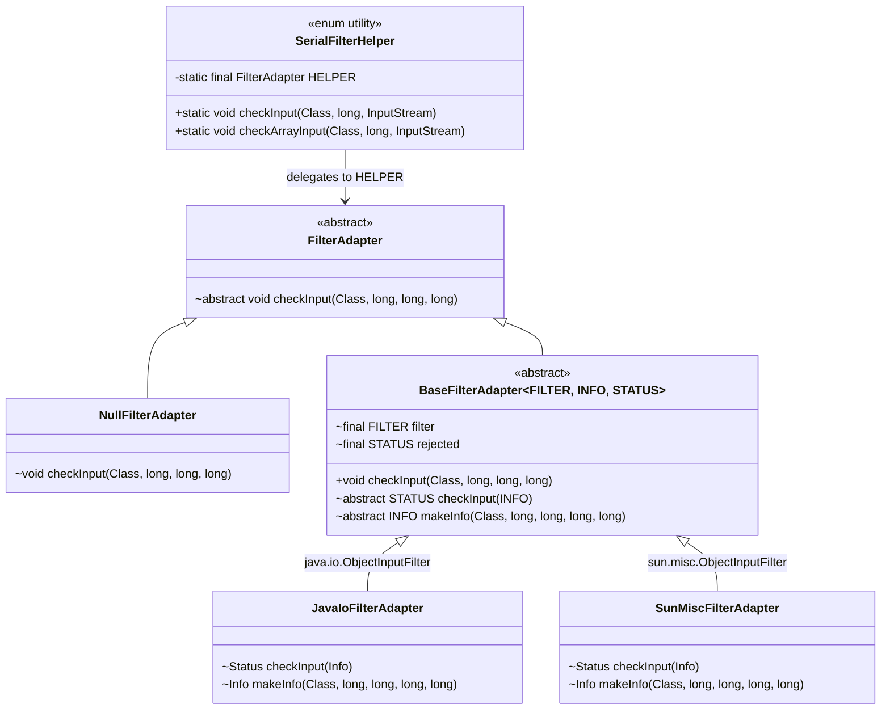

# Cross-Version JEP 290 Implementation in Apache Yoko

## 1. Overview and Problem Statement

[JEP 290](https://openjdk.org/jeps/290) ("Filter Incoming Serialization Data") introduces deserialization filtering to protect against serialization-based vulnerabilities. However, supporting JEP 290 across multiple Java runtime versions presents a binary and API compatibility challenge:

- **Java 7 and earlier:** No serialization filter mechanism exists.
- **Java 8 (8u121+):** JEP 290 was backported under the private package `sun.misc.ObjectInputFilter`.
- **Java 9+:** Standardized in the public API under `java.io.ObjectInputFilter`.

### Key Constraints in Yoko
1. **Compilation Compatibility:** Yoko production artifacts target Java 8 bytecode (`sourceCompatibility = targetCompatibility = 1.8`). Under standard Java 8 toolchains, `java.io.ObjectInputFilter` does not exist. Under Java 9+ toolchains, `sun.misc.ObjectInputFilter` is encapsulated and restricted.
2. **Runtime Portability:** The resulting JAR must run unmodified on Java 8, Java 11, Java 17, and Java 21+ runtimes.
3. **High Performance / Low Overhead:** Deserialization occurs on performance-critical paths. Dynamic reflection (`Method.invoke()`) and dynamic proxies (`java.lang.reflect.Proxy`) incur unacceptable invocation overhead.

---

## 2. Architecture and Design

Yoko resolves this challenge without reflection at runtime by combining **compile-time stubbing** with a **polymorphic adapter hierarchy and classloader fallback**.



---

## 3. Detailed Mechanism

### 3.1. Compile-Time Bridge: Dummy Stubs (`compileOnly`)

To compile direct references to both `java.io.ObjectInputFilter` and `sun.misc.ObjectInputFilter` on a Java 8 target, Yoko includes a lightweight internal module named `jdk-supplement`:

- [`jdk-supplement/src/main/java/java/io/ObjectInputFilter.java`](../../jdk-supplement/src/main/java/java/io/ObjectInputFilter.java)
- [`jdk-supplement/src/main/java/sun/misc/ObjectInputFilter.java`](../../jdk-supplement/src/main/java/sun/misc/ObjectInputFilter.java)

These stub files mirror the method signatures required by Yoko:
```java
package java.io;

public interface ObjectInputFilter {
    interface FilterInfo {
        Class<?> serialClass();
        long arrayLength();
        long depth();
        long references();
        long streamBytes();
    }

    class Config {
        public static ObjectInputFilter getSerialFilter() {
            throw new UnsupportedOperationException();
        }
    }

    enum Status { REJECTED }

    Status checkInput(FilterInfo info);
}
```

In `yoko-rmi-impl/build.gradle`:
```groovy
dependencies {
    compileOnly project(":jdk-supplement")
}
```

**Why this works:**
- `compileOnly` provides the necessary symbols to `javac` during build time without packaging the dummy classes into the shipped JAR.
- At runtime, the JVM resolves the classes against the actual JRE classes (`java.base` on Java 9+, or `rt.jar` on Java 8).

---

### 3.2. Polymorphic Adapter Hierarchy

Yoko abstracts the filter operations using generic type parameters:

```java
abstract static class BaseFilterAdapter<FILTER, INFO extends BaseInfo, STATUS extends Enum<STATUS>> extends FilterAdapter {
    final FILTER filter;
    private final STATUS rejected;

    BaseFilterAdapter(FILTER filter, STATUS rejected) {
        this.filter = Objects.requireNonNull(filter);
        this.rejected = Objects.requireNonNull(rejected);
    }

    @Override
    public final void checkInput(Class<?> serialClass, long arrayLength, long depth, long streamBytes)
            throws InvalidClassException {
        final long references = 1;
        INFO info = makeInfo(serialClass, arrayLength, depth, references, streamBytes);
        STATUS status;
        try {
            status = checkInput(info);
        } catch (Exception e) {
            throw (InvalidClassException) new InvalidClassException("Rejected by serialFilter: " + serialClass.getName()).initCause(e);
        }
        if (status == null || status == rejected) {
            throw new InvalidClassException("Rejected by serialFilter: " + serialClass.getName());
        }
    }

    abstract STATUS checkInput(INFO info);
    abstract INFO makeInfo(Class<?> serialClass, long arrayLength, long depth, long references, long streamBytes);
}
```

Each variant binds directly to its concrete package types:

- **Java 9+ Adapter (`JavaIoFilterAdapter`):**
  ```java
  final class JavaIoFilterAdapter extends BaseFilterAdapter<ObjectInputFilter, Info, Status> {
      JavaIoFilterAdapter() { super(Config.getSerialFilter(), REJECTED); }

      @Override
      Status checkInput(Info info) { return filter.checkInput(info); }

      @Override
      Info makeInfo(Class<?> serialClass, long arrayLength, long depth, long references, long streamBytes) {
          return new Info(serialClass, arrayLength, depth, references, streamBytes);
      }

      static final class Info extends BaseInfo implements FilterInfo {
          public Info(Class<?> serialClass, long arrayLength, long depth, long references, long streamBytes) {
              super(serialClass, arrayLength, depth, references, streamBytes);
          }
      }
  }
  ```

- **Java 8 Adapter (`SunMiscFilterAdapter`):**
  Identical structure, but imports `sun.misc.ObjectInputFilter`, `sun.misc.ObjectInputFilter.Config`, etc.

- **No-Op Adapter (`NullFilterAdapter`):**
  Used on Java 7 or runtimes where no filter is configured/available; `checkInput()` is a no-op.

---

### 3.3. Static Initializer Selection Strategy

The active adapter is selected once at class load time in [`SerialFilterHelper`](../../yoko-rmi-impl/src/main/java/org/apache/yoko/rmi/util/SerialFilterHelper.java:45):

```java
public enum SerialFilterHelper {
    ;
    private static final FilterAdapter HELPER;

    static {
        FilterAdapter filterAdapter;
        try {
            // Attempt standard Java 9+ java.io implementation first
            filterAdapter = new JavaIoFilterAdapter();
        } catch (Throwable t1) {
            try {
                // Fall back to Java 8 sun.misc implementation
                filterAdapter = doPrivileged((PrivilegedExceptionAction<FilterAdapter>) SunMiscFilterAdapter::new);
            } catch (Throwable t2) {
                // Fall back to no-op for Java 7 or unpatched runtimes
                filterAdapter = new NullFilterAdapter();
            }
        }
        HELPER = filterAdapter;
    }
}
```

#### Classloading Execution Flow:
1. **On Java 9+:** `new JavaIoFilterAdapter()` succeeds. `SunMiscFilterAdapter` is never loaded.
2. **On Java 8:** `new JavaIoFilterAdapter()` throws `NoClassDefFoundError` (caught as `Throwable`). The fallback tries `SunMiscFilterAdapter`, which succeeds.
3. **On Java 7 / Unpatched Java 8:** Both throw errors; `NullFilterAdapter` is instantiated.

---

## 4. Performance Optimizations (Zero Reflection)

1. **Zero Runtime Reflection:**
   - No `Method.invoke()`, `Class.forName()`, or `MethodHandle` invocations occur during stream filtering.
   - All filter calls compile to standard, direct bytecode instructions (`invokevirtual`, `invokeinterface`, `invokestatic`).
2. **One-Time Classloading Cost:**
   - The fallback resolution runs exactly once during class initialization. Subsequent invocations incur no selection overhead.
3. **Monomorphic Call Sites & JIT Inlining:**
   - Because `HELPER` is `private static final`, HotSpot / OpenJ9 JIT compilers identify the call site `HELPER.checkInput(...)` as monomorphic.
   - The JIT compiler can inline the adapter call directly into the calling method, matching the performance of a direct JVM method call.
4. **Direct Interface Implementation:**
   - Instead of wrapping filter arguments with dynamic proxies or reflective invocation handlers, `Info` classes directly implement `FilterInfo`. Object instantiation is cheap, type-safe, and eligible for escape analysis.

---

## 5. Blueprint: Replicating This Pattern

To implement a similar multi-version cross-package pattern in another library:

1. **Create Compile-Time Stubs:**
   Add a `compileOnly` subproject containing dummy interfaces/classes with matching signatures for the classes missing in the target compilation JDK.
2. **Define an Internal Abstract Adapter:**
   Create an internal abstract class/interface defining the operations required by your library.
3. **Implement Version-Specific Adapters:**
   Write concrete adapter classes that directly import each package variant and implement the internal interface.
4. **Select Adapter via Classloader Fallback:**
   In a static initializer, attempt instantiation in order of version preference inside `try ... catch (Throwable)` blocks. Store the result in a `static final` field.
